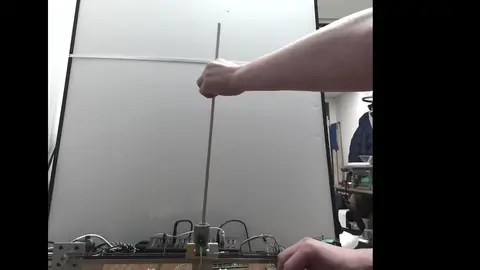
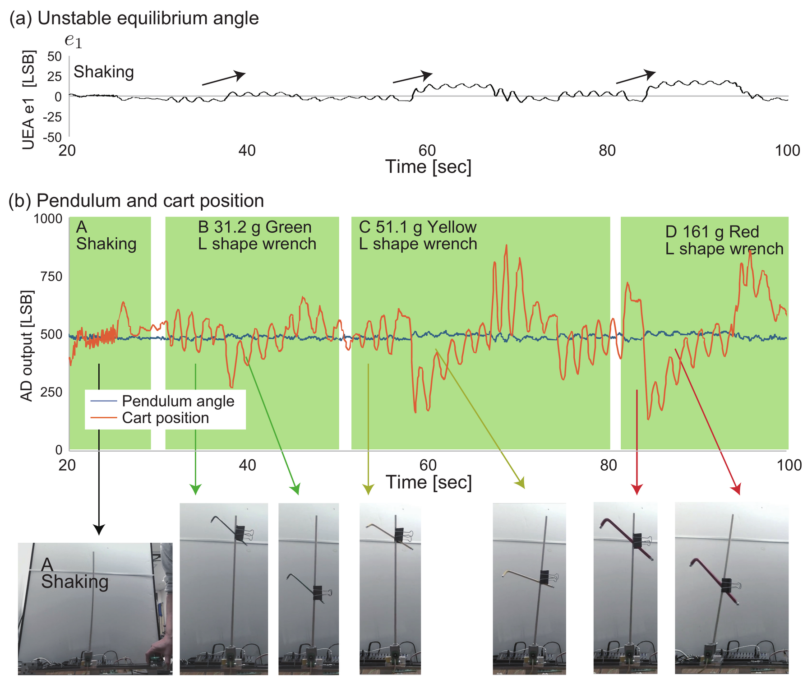
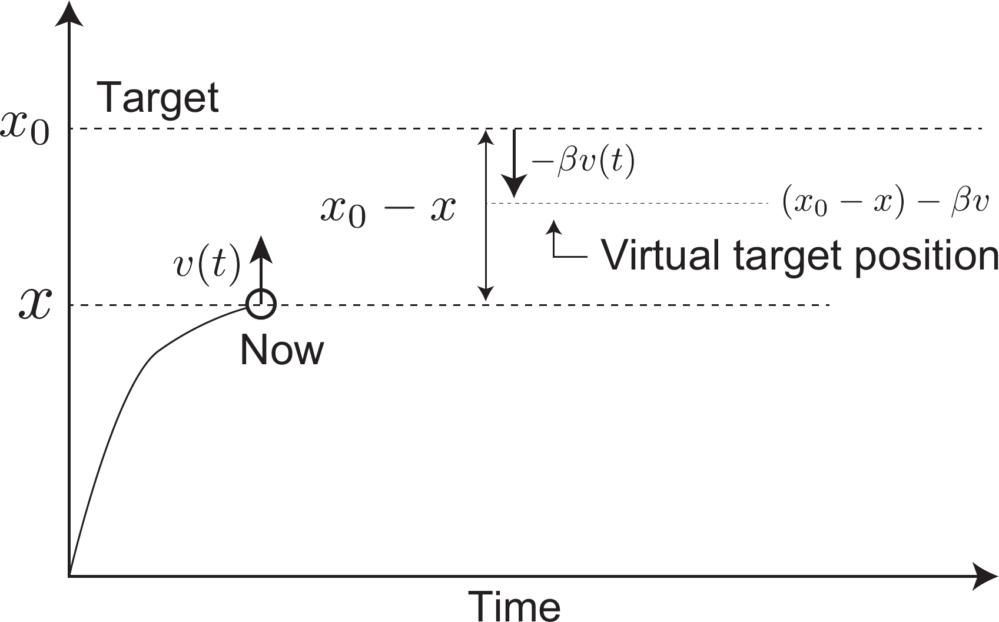

# Pendulum Model-Less Inversion — Demo Movie

この動画は、下記論文の成果として撮影した実機実験のデモ映像です（167秒・ノーカット）。
This is the demonstration movie of the hardware experiment reported in the paper below (167 s, uncut).

🎬 **[Full movie with sound（プレイヤーページ）](https://lect.mydns.jp/ee/movie.html)** ／ [MP4 direct (18.8 MB)](https://lect.mydns.jp/ee/movie.mp4)

## Paper

**Pendulum Model-Less Inversion**
Hideki Toda, Masahiro Sekimoto, Junji Ohyama, and Hiroaki Kawamoto
*Journal of Robotics and Mechatronics*, Vol. 38, No. 1, pp. 350–363, 2026.

- Publisher: <https://www.fujipress.jp/jrm/rb/robot003800010350/>
- DOI: <https://doi.org/10.20965/jrm.2026.p0350>
- Received: March 17, 2025 / Accepted: October 11, 2025 / Published: February 20, 2026
- License: CC BY-ND 4.0

## Abstract

This paper presents a novel approach to inverted pendulum control and unstable equilibrium angle (UEA) estimation through a proposed velocity suppression mechanism implemented in a single code. The key innovation lies in achieving control using solely an integral controller whose parameters satisfy a specific velocity suppression condition. Traditional inverted pendulum systems face a fundamental challenge: the arduous task of finding optimal proportional–differential–integral parameters, complicated by the system's inherent sensitivity to minor physical variations (such as pendulum weight, length, distortion, and cart-rail friction). Our solution introduces a streamlined integral controller that includes the pendulum's position, velocity parameters (θ, θ̇), achieving stabilization through the proposed mechanism. This same mechanism is effectively utilized for UEA estimation. The effectiveness was demonstrated on an unknown layout, weight, and moment pendulum inversion with unknown friction or deteriorated effect of 12-years-old device. This work signals a paradigm shift away from complex, model-dependent approaches to more practical, adaptive solutions.

**Keywords:** inverted pendulum, unstable equilibrium angle estimator, integral only controller, anti-friction, non predictable disturbances

## Figure 6

*Fig. 6. Example of pendulum and cart position transition during base shaking by hand (area A) L-shaped wrench attachment (areas B–D) in the same movie. (a) UEA estimated by listing 2. (b) The pendulum (blue) and cart (red) position transition.*
Reproduced unmodified from the published paper: H. Toda, M. Sekimoto, J. Ohyama, and H. Kawamoto, "Pendulum Model-Less Inversion," *Journal of Robotics and Mechatronics*, Vol. 38, No. 1, pp. 350–363, 2026. Licensed under [CC BY-ND 4.0](https://creativecommons.org/licenses/by-nd/4.0/).

## Movie files

| file | format | size | note |
|---|---|---|---|
| `movie.webp` | animated WebP, 480×270, 10 fps | 7.1 MB | shown above (lightweight) |
| `movie.gif` | GIF, 480×270, 10 fps | 47.8 MB | previous version, kept as fallback |
| `movie.mp4` | MP4 (H.264 + AAC), 1280×720, 60 fps | 18.8 MB | original movie, [player page](https://lect.mydns.jp/ee/movie.html) |

## License

- Source code in this repository: Apache-2.0 (see `LICENSE`)
- The paper: CC BY-ND 4.0
- `fig6.png` is a reproduction of Fig. 6 of the paper (CC BY-ND 4.0, unmodified) and is **not** covered by Apache-2.0

<!--
旧GIF版を表示に戻すときは、上の  のURLを movie.gif に変えるだけ。

図1（ブロック図）に戻すときは、Figure 6 セクションをこれと入れ替える（fig1.png はリポジトリに残してある）。
## Figure 1

-->
